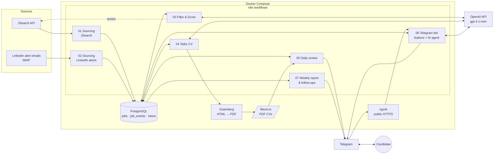
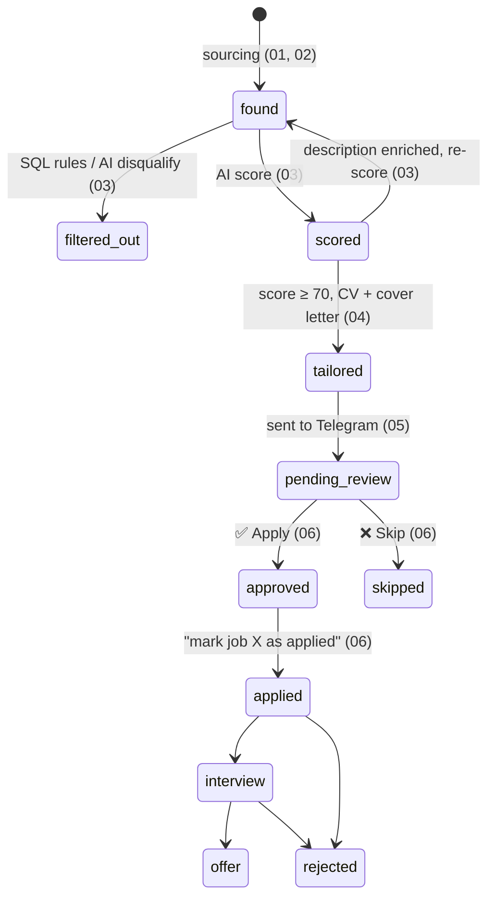

# 🤖 Job Hunting Copilot

A self-hosted job search automation built with **n8n, PostgreSQL, the OpenAI API, Gotenberg and Telegram**.

It collects job postings every day, drops the obvious mismatches with free SQL rules, scores the rest with AI against a structured candidate profile, writes a **tailored one-page CV (PDF) and cover letter** for the best matches, and sends them to Telegram for a one-tap **Apply / Skip** decision. Every status change is logged, so the whole funnel, from *found* to *offer*, can be measured and tuned.

> Human in the loop by design: the copilot prepares everything, but it never applies to a job on its own.

---

## ✨ Features

- **Multi-source sourcing**: JSearch API (aggregates LinkedIn, Indeed, Glassdoor…) plus LinkedIn job alert emails read over IMAP.
- **Deduplication**: every job gets an `md5(company | title | location)` hash, so the same posting from two sources is stored once.
- **Cost-aware filtering**: SQL rules (seniority, off-target titles, minimum salary, location/remote) run *before* the AI, so obvious rejects cost nothing.
- **AI scoring with a strict JSON schema**: a 0–100 score with a defined rubric, matched/missing skills, red flags, a short reasoning and an optional disqualify reason.
- **Description enrichment**: promising LinkedIn jobs scored from the title alone are looked up in JSearch and re-scored with the full description.
- **CV tailoring with a fact check**: the AI may only select, reorder and rephrase profile content. A validation step removes unknown skills/projects, restores any bullet that contains numbers not in the profile, and records every fix it made.
- **PDF rendering**: the tailored CV is rendered as HTML and converted to an A4 PDF by Gotenberg (headless Chromium).
- **Telegram review**: each CV arrives as a PDF with its score, skills, red flags and ✅ Apply / ❌ Skip buttons.
- **Conversational agent**: a Telegram AI agent with memory and 5 read/write database tools ("show me jobs above 80", "mark job 42 as applied", "how many applications this week?").
- **Weekly report and follow-ups**: funnel numbers, response and interview rates, top filter reasons, and reminders for applications with no answer.
- **Prompt-injection hardening**: job postings are wrapped in `<job_posting>` tags and treated as untrusted data in every prompt.
- **Audit trail**: a PostgreSQL trigger logs every status change in `job_events`.

---

## 🏗️ Architecture



### Job lifecycle

Every job moves through these statuses. Each transition is written to `job_events` by a trigger.



---

## 🔁 Workflows

| # | Workflow | Trigger | What it does |
|---|----------|---------|--------------|
| 01 | **Sourcing (JSearch)** | Daily 07:00 | Runs a configurable list of searches, normalizes results (title, company, location, remote flag, salary, publisher) and inserts new jobs. |
| 02 | **Sourcing (LinkedIn alerts)** | New IMAP email | Parses LinkedIn job alert emails into jobs, detects remote/hybrid/on-site and rebuilds clean job URLs without tracking parameters. |
| 03 | **Filter & Score** | 07:30 & 18:30 (+ 07:15 enrichment) | Applies SQL rule filters, then scores up to 25 jobs per run with OpenAI (strict JSON schema, batched requests). A separate branch enriches promising title-only LinkedIn jobs with a JSearch description. |
| 04 | **Tailor CV** | 08:00 & 19:00 | Picks the best jobs (score ≥ 70, max 10/day), asks the AI for a tailored headline, summary, skill order, projects and cover letter in the posting's language (EN/ES), validates it against the profile, renders a PDF with Gotenberg and saves it. |
| 05 | **Daily review (Telegram)** | 08:30 & 19:30 | Sends each tailored CV as a PDF with a rich caption and Apply/Skip inline buttons. |
| 06 | **Telegram bot (buttons + agent)** | Telegram webhook | Restricted to one allowed chat ID. Button presses save the decision and reply with the apply link and cover letter. Text messages go to an AI agent with conversation memory and database tools. |
| 07 | **Weekly report & follow-ups** | Monday 08:45 / daily 09:00 | Sends a weekly funnel report and reminders for jobs applied 7+ days ago or approved 3+ days ago without action. |

### Telegram agent tools

| Tool | Purpose |
|------|---------|
| `pipeline_summary` | Jobs and average score per status, plus jobs found in the last 24 h |
| `search_jobs` | List jobs by status and minimum score |
| `job_details` | Everything about one job: link, score, skills, red flags, filter reason, salary, review fixes |
| `update_job_status` | Change one job's status (allow-listed statuses only) |
| `activity_stats` | Status changes over the last N days |

---

## 🗄️ Database

The schema is created automatically from [`init/`](init/) the first time the Postgres volume is created.

| Script | Adds |
|--------|------|
| `01_jobs_schema.sql` | `jobs` table, `job_events` history, `updated_at` + status-logging triggers, `pipeline_summary` view |
| `02_add_salary_publisher.sql` | Publisher and salary columns (min, max, currency, period) |
| `03_scoring_columns.sql` | `score_confidence` (`full` / `title_only`) and `enrich_attempted` |
| `04_tailoring_columns.sql` | `tailored_cv` JSONB (tailored content + validation notes) |
| `05_tracking.sql` | `followup_sent_at` and tuning views |

**Tuning views**

- `tuning_by_source`: how each source performs through the funnel.
- `tuning_filter_reasons`: why jobs are dropped, to catch good jobs filtered by mistake.
- `tuning_score_vs_decision`: does the AI score agree with your Apply/Skip decisions?

---

## 🧰 Tech stack

| Layer | Technology |
|-------|-----------|
| Orchestration | n8n (self-hosted) |
| Database | PostgreSQL 16 |
| AI | OpenAI API (`gpt-4.1-mini`, structured outputs, n8n AI Agent) |
| PDF rendering | Gotenberg 8 (Chromium) |
| Job data | JSearch API, LinkedIn alert emails (IMAP) |
| Interface | Telegram Bot API |
| Networking | ngrok static domain (public webhooks) |
| Infrastructure | Docker Compose |

---

## 📁 Project structure

```
.
├── docker-compose.yml        # n8n, PostgreSQL, Gotenberg, ngrok
├── env.example               # Environment variables template
├── init/                     # SQL schema, run on first database start
├── automations/              # n8n workflow exports (01–07)
└── files/
    ├── master_profile.json   # Candidate profile: single source of truth
    └── cvs/                  # Generated PDF CVs (git-ignored)
```

---

## 🚀 Getting started

### Prerequisites

- Docker and Docker Compose
- An [ngrok](https://ngrok.com/) account with a free static domain
- An OpenAI API key
- A JSearch API key ([OpenWeb Ninja](https://www.openwebninja.com/))
- A Telegram bot token from [@BotFather](https://t.me/BotFather)
- *(Optional)* an email inbox receiving LinkedIn job alerts, with IMAP access

### 1. Configure the environment

```bash
cp env.example .env
# edit .env: timezone, ngrok token and domain, database name/user/password
```

### 2. Start the stack

```bash
docker compose up -d
```

n8n is available at `http://localhost:5678` and publicly at `https://<NGROK_DOMAIN>`. PostgreSQL is exposed only on `127.0.0.1:5433` for local tools like DBeaver or psql.

### 3. Create credentials in n8n

| Credential | Notes |
|------------|-------|
| Postgres | Host `postgres`, port `5432`, database/user/password from `.env` |
| OpenAI | Used by the HTTP Request nodes (03, 04) and the agent's chat model (06) |
| JSearch | API key for the HTTP Request nodes in 01 and 03 |
| Telegram | Bot token |
| IMAP | Inbox that receives LinkedIn alerts (workflow 02) |

### 4. Import and configure the workflows

1. Import every file from [`automations/`](automations/) into n8n and attach the credentials above.
2. Replace `YOUR_CHAT_ID` with your Telegram chat ID in workflows **05** (*Build caption*), **06** (allowed-chat check) and **07** (*Format report*, *Format follow-ups*).
3. Fill in [`files/master_profile.json`](files/master_profile.json) with your own profile, then update the embedded copies: the `PROFILE` constant in workflow **03** (*Build AI request*, compact text version) and workflow **04** (*Build tailoring request*, full JSON).
4. Adjust the searches in workflow **01** (*Search list*) and the rule filters in workflow **03** (*Apply rule filters*) to your target roles, location and minimum salary.
5. Activate the workflows.

> The `init/` scripts only run when the database volume is created for the first time. To apply a new script to an existing database, run it manually with `psql`.

---

## ⚙️ Configuration knobs

| Setting | Where |
|---------|-------|
| Search queries and countries | Workflow 01 → *Search list* |
| Rule filters (seniority, titles, salary floor, locations) | Workflow 03 → *Apply rule filters* |
| Scoring rubric and disqualify rules | Workflow 03 → *Build AI request* (`SYSTEM`) |
| OpenAI model | `MODEL` constant in workflows 03 and 04; chat model node in 06 |
| Minimum score to tailor and daily limit (70 / 10) | Workflow 04 → *Pick jobs to tailor* |
| Enrichment budget (2 lookups/day) | Workflow 03 → *Pick LinkedIn jobs to enrich* |
| Follow-up delays (7 days applied / 3 days approved) | Workflow 07 → *Jobs to follow up* |
| Schedules | Each workflow's Schedule Trigger (cron) |

---

## 🔒 Security & privacy

- Secrets live in `.env`, which is git-ignored. `env.example` is the template.
- Generated CVs are git-ignored because they contain contact details.
- PostgreSQL is bound to `127.0.0.1` and Gotenberg is internal to the Docker network.
- The Telegram bot only responds to one allowed chat ID.
- The agent can only set allow-listed statuses, and all SQL uses parameterized queries.
- Job postings are treated as untrusted input in every prompt.
- The CV validation step prevents the AI from inventing skills, projects or numbers.

---

## 🛣️ Possible improvements

- Load `master_profile.json` from disk at runtime instead of embedding copies in workflows 03 and 04.
- Move the Telegram chat ID to an environment variable.
- Add more sources (Greenhouse, Lever, company career pages).
- Build a dashboard on top of the tuning views.
